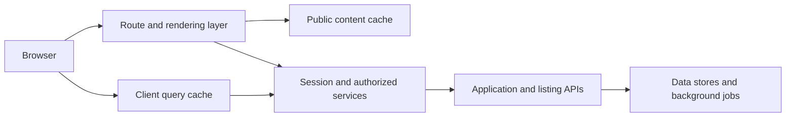

# 33. Front-end system design

Previous: [32. Native and Expo](32-react-native-and-expo.md) | Next: [34. Component design](34-component-and-design-system-interviews.md)

## A 45-minute structure

Spend about 5 minutes clarifying users and scope, 5 defining requirements and data, 10 proposing architecture, 15 exploring two important constraints, 5 covering failure/testing/delivery, and 5 summarizing tradeoffs and open questions. These are pacing guides, not a script to ignore interviewer steering.

Ask about platforms, SEO, auth, tenant scope, data volume, update rate, target devices/networks, accessibility, localization, and offline needs. Separate stated facts from assumptions. Translate scale into UI constraints: visible rows, concurrent requests, event frequency, and acceptable staleness. A platform's total customer count does not tell you every screen's active concurrency.

## Worked design: multi-tenant housing marketplace

Requirements: public discovery/detail routes; city, price, and sort filters; pagination; saved listings; authenticated applications; tenant-scoped administration. Public content should have useful initial HTML. Private data should remain private. Filter URLs should be shareable. Establish measurable budgets and freshness requirements with the interviewer.

This is a proposed practice design, not a claim about your employer's architecture. Choose Vite SPA, Next.js, or Start by rendering/runtime needs. Discuss where the existing Rails service remains authoritative during migration.

Define a listing summary versus detail contract, filter schema, deterministic sort, page/cursor rules, and application mutation. Separate public cache identity from user/tenant query keys. Keep form draft local to the application workflow; do not put contact details in the URL.

## Explore two constraints deeply

**Fresh inventory or availability:** show last-updated state, choose polling/SSE only if needed, reconcile on focus/reconnect, and invalidate after a confirmed change. Protect edits from old background sync results. Explain what stale data is acceptable and what must be rechecked at submission.

**Permission and tenant isolation:** authenticate at the server boundary, verify current membership, query by tenant plus record ID, enforce operation permission, and test direct calls from a different tenant. Scope sockets, caches, and persisted drafts. A client role check is helpful UX but not enforcement.

Other deep dives: image-heavy discovery performance, accessible filter/dialog interaction, mobile networks, search relevance, optimistic saves, autosave conflicts, route migration, or design-system reuse. Choose the ones the requirements make important.

## Alternative prompts

| Prompt | Clarify | Deep dive |
| --- | --- | --- |
| Inventory admin for game stores | Rows, bulk edits, freshness, export | Virtualization vs paging, conflict/version UI, background job progress |
| Resident bills/tasks app | Shared edits, reminders, offline | Optimistic actions, entitlement, notification/deep-link safety |
| LMS quizzes | Time limits, autosave, grading contract | Draft versioning, reconnect, authoritative submission deadline |
| Analytics dashboard | Aggregations, range filters, live updates | Parallel loading, charts accessibility, stale queries, partial failures |
| Collaborative board | Concurrent edits, presence, offline | Event ordering, conflict resolution, reconnect, optimistic identifiers |

Do not jump to micro-frontends or a monorepo as a default. Micro-frontends can support independent ownership/deployment, but introduce runtime duplication, integration contracts, shared auth, CSS, accessibility, and observability costs. A modular application may be sufficient.

## Failure, rollout, and assessment

Cover empty/error/partial states, canceled requests, authentication expiry, rate limiting, retries, unavailable third parties, stale deployments, and rollback. Add unit/interaction/contract/browser tests based on risk. Observe request errors, key interaction latency, web vitals, job status, and rollout cohorts without logging secrets.

Strong answers connect requirements to choices and acknowledge costs. Weak answers list libraries without tracing a user action. Exit gate: deliver one 45-minute design, draw data flow, define three contracts, and defend two alternatives with measurable consequences.
